[English](README.md) · Français

<div align="center">
  
  <h1>NovyDeck</h1>
  <p>Logiciel libre pour Windows qui pilote les stream decks : touches, macros, médias et plugins, sans le logiciel officiel. Testé sur le FIFINE AmpliGame D6 et l'Elgato Stream Deck.</p>
  <p><a href="https://hatiflash.github.io/NovyDeck/">Découvrir le site NovyDeck</a></p>
  <p>
    <a href="https://github.com/HatiFlash/NovyDeck/releases/tag/v0.15.0"></a>
    <a href="LICENSE"></a>
    
  </p>
</div>


<sub>Capture réelle de l'interface, rendue hors écran à 2560 × 1600 avec le profil « NovyDeck Demo / README » fourni avec l'application, sans périphérique connecté.</sub>

## Vidéo de présentation

[](docs/media/novydeck-demo.mp4)

Un film de présentation de 40 s en 1920 × 1080 à 60 i/s, avec son, réalisé avec Remotion et three.js. Il montre le pavé D6 en 3D, de vraies captures de l'interface et une musique synthétisée. Le film publié a été produit hors du dépôt.

## Nouveautés 0.15.0

### En-tête du deck et bibliothèque plus clairs

Sur l'écran principal du deck, l'en-tête indique si l'exécution des touches est active ou en pause. La bibliothèque nomme explicitement ses sections **Modèles** et **Enregistrés**.

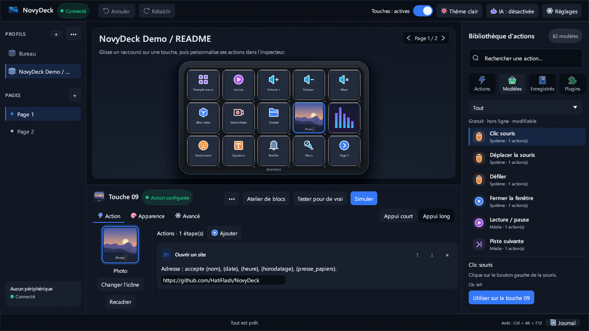

### Plus de place dans l'inspecteur de touche

Sélectionnez une touche pour afficher ses étapes d'action dans l'inspecteur ; la disposition garde les premières étapes visibles en petite fenêtre et en HiDPI. L'onglet **Apparence** reste défilable pour accéder à ses réglages. Sa case carrée cochée et l'onglet Apparence lui-même datent de la version 0.13 ; ils sont montrés comme contexte, pas comme nouveautés de la 0.15.

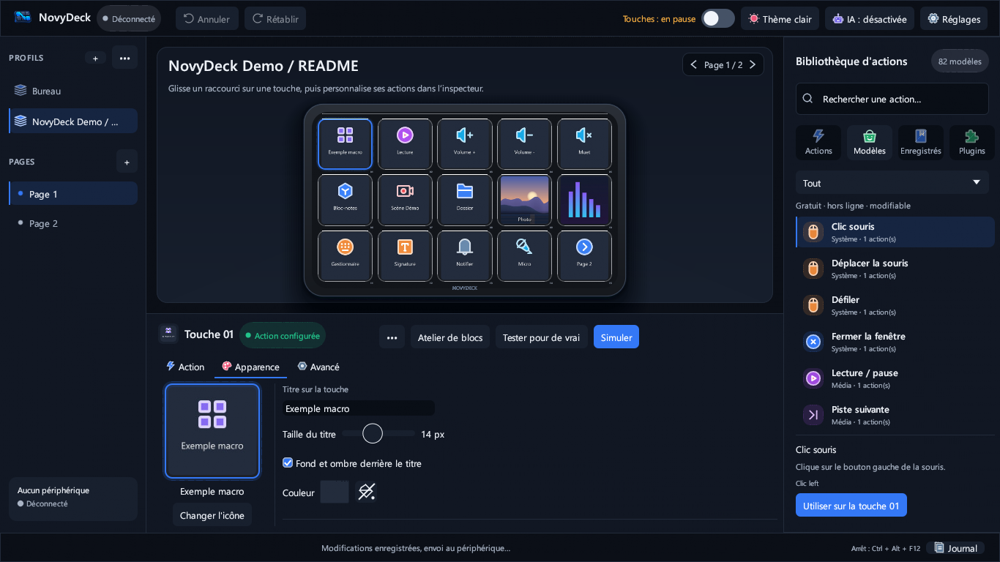

### Conversations avec l'assistant et propositions à relire

Depuis une touche vide, choisissez **Demander à l’IA** pour ouvrir **Atelier → Assistant**. Les demandes et réponses apparaissent dans l'ordre de la conversation. Une proposition reconnue affiche son nombre de blocs et un aperçu structuré, y compris les branches imbriquées ; il faut la relire puis choisir **Ajouter** ou **Appliquer** avant de modifier la touche. Les règles déterministes intégrées restent disponibles sans modèle IA. Un modèle IA local facultatif peut traiter des demandes au-delà de ces règles ; il ne comprend pas universellement les plugins, et leurs actions et réglages sont validés plutôt que supposés. Cela ne garantit ni un modèle particulier ni un fonctionnement matériel réussi.

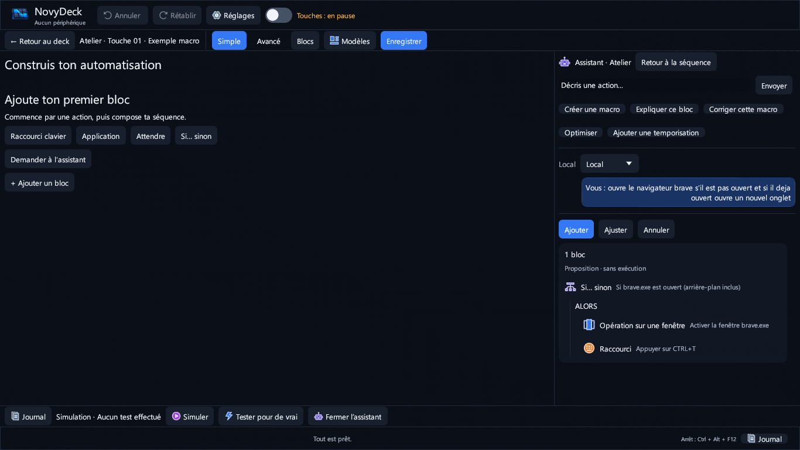

La vue distincte de clarification montre l'assistant demandant quel plugin ou quelle action est visé. Elle utilise la fixture SoundPad hors ligne, et non un vrai plugin installé ; elle ne démontre pas une compréhension réelle des plugins.

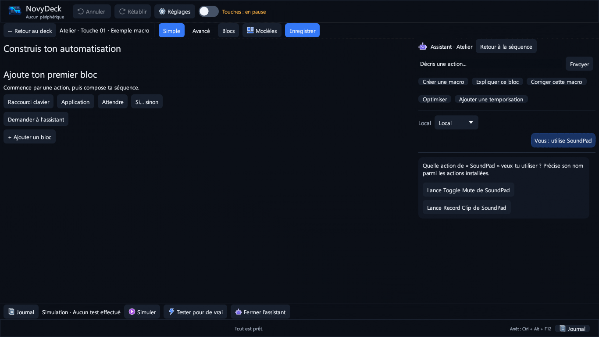

## Nouveautés 0.14.0

### Modification directe des blocs dans l'Atelier

Ouvrez une touche, puis **Atelier → Simple**. Faites glisser un bloc par sa poignée pour le réordonner ou l'imbriquer dans **Alors**, **Sinon** ou **Répéter**. Maintenez **Ctrl** pour dupliquer pendant le glissement ; **Échap** l'annule. **Annuler** et **Rétablir** couvrent les modifications, et la liste défile automatiquement près de ses bords. Cliquez sur un bloc pour le modifier dans le panneau **Propriétés**.

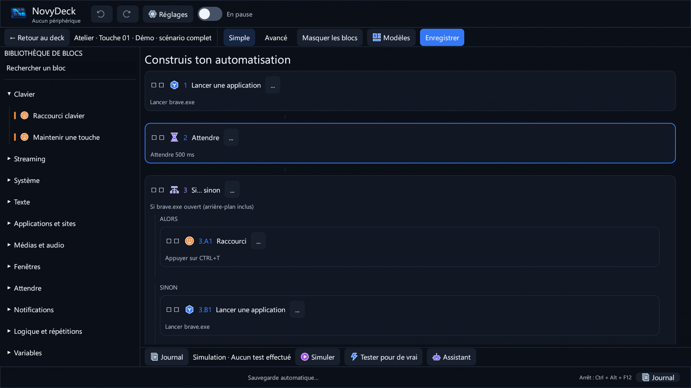

### Cartes Quoi de neuf actualisées et progression honnête

Dans **Réglages → À propos**, vérifiez les mises à jour. L'offre et la fenêtre **Quoi de neuf** présentent les nouveautés sous forme de cartes. La fenêtre d'installation distingue Téléchargement, Vérification SHA-256, Installation et Relance. Si le nombre d'octets reçus n'est pas disponible, la progression reste indéterminée : aucun pourcentage n'est inventé.

| Offre de mise à jour | Quoi de neuf |
| --- | --- |
| 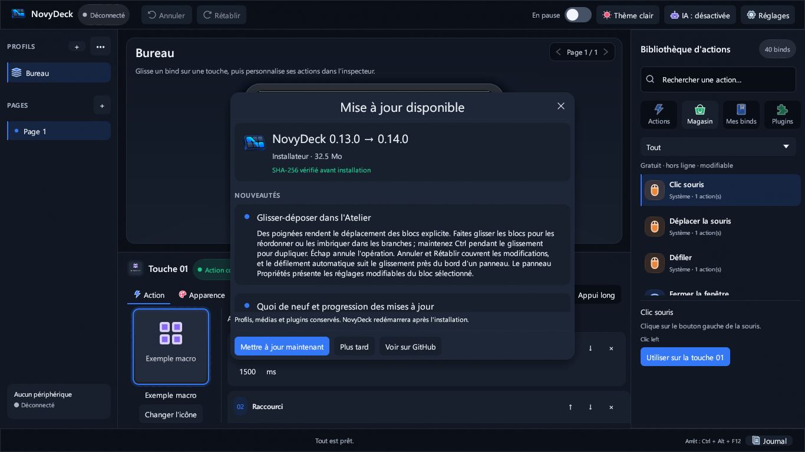 | 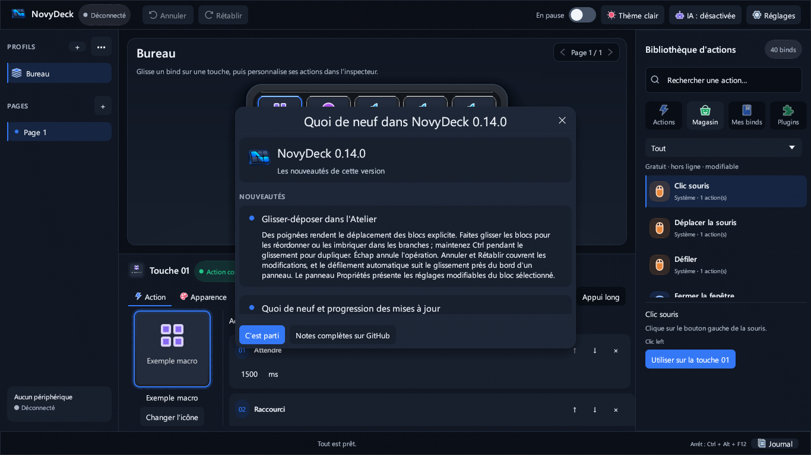 |

### Assistant et actions des plugins installés

Dans **Atelier → Assistant**, décrivez l'action voulue. L'assistant local cherche dans les manifestes des plugins installés et demande une précision si le plugin, l'action ou la cible est ambiguë. Il n'invente pas les réglages privés d'un inspecteur tiers : renseignez-les dans l'inspecteur du plugin. Cela ne garantit pas la compréhension de toute demande ; aucun bloc n'est inséré sans relecture et application de la proposition. Un modèle IA local est nécessaire pour les demandes au-delà des règles intégrées.

## Nouveautés 0.13.0

### Navigation physique sans action involontaire

Ouvrir un dossier ou revenir à l'accueil doit consommer l'appui de navigation, sans activer la touche située au même emplacement dans l'écran de destination. Le suivi de l'appui physique est conservé pendant la synchronisation de page et ignore les rapports d'appui répétés jusqu'au relâchement.

### Retour visuel plus réactif

Les événements de touche HID réveillent explicitement l'interface au lieu d'attendre un rafraîchissement déclenché par une autre activité. Le cache d'aperçu LCD suit également le choix du fond du titre. Ce sont les chemins logiciels testés qui sont corrigés : aucune mesure de latence sur un D6 physique n'est annoncée, et les mises à jour des plugins dépendent encore de leur réponse.

### Texte sans fond ajouté

Dans l'onglet **Apparence** d'une touche, décochez **Fond et ombre derrière le titre** pour garder seulement le texte sur votre image. Les profils existants conservent leur rendu par défaut. Ce choix est enregistré et s'applique à l'aperçu comme à l'image envoyée au périphérique.

| Fond activé | Fond désactivé |
| --- | --- |
| 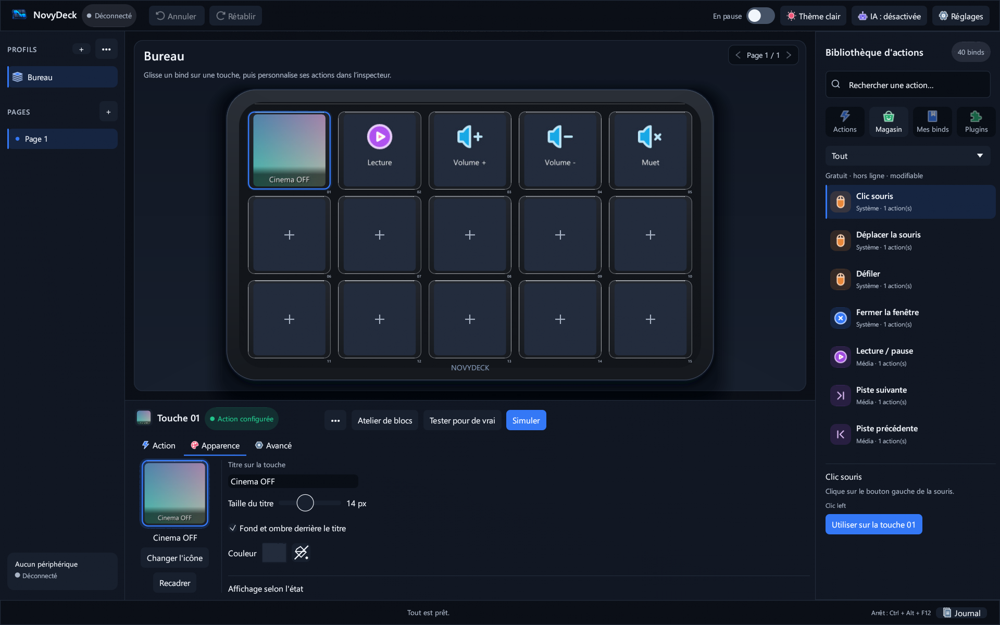 | 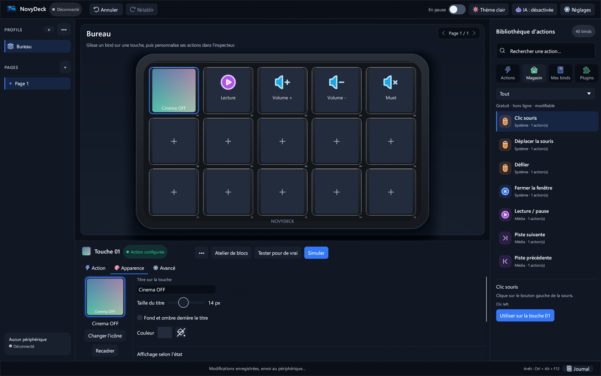 |

### Menu Ajouter une action défilable

Dans l'onglet **Action** de l'inspecteur de touche, le menu **Ajouter** a maintenant une hauteur bornée et permet d'atteindre la dernière action par défilement, y compris en petite fenêtre et en HiDPI.

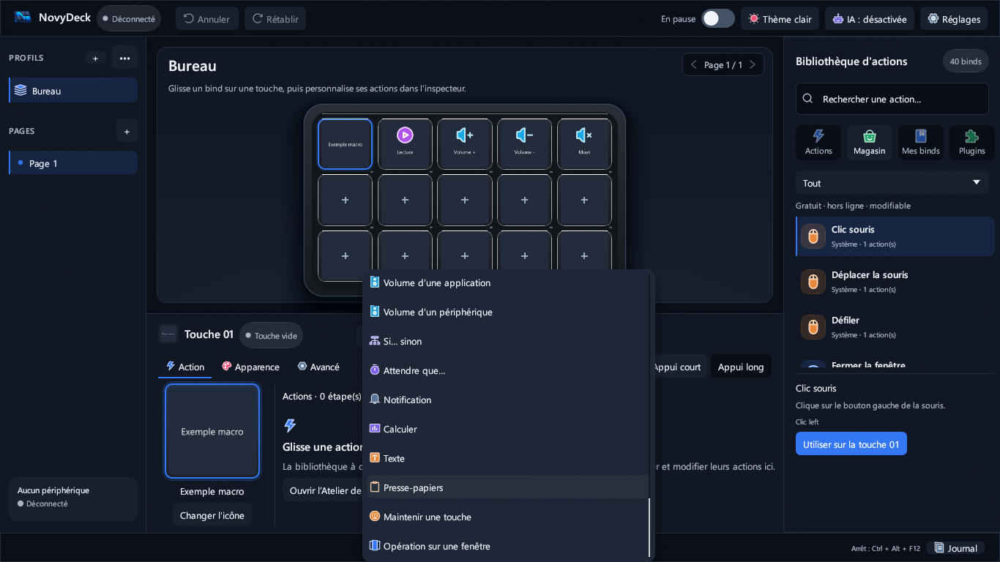

### Wallpaper Engine : Arrêt / Lecture

Mettez à jour le plugin séparé Wallpaper Engine en **1.0.6** dans le magasin, puis choisissez **Stop / Play (all screens)** dans ses actions installées. Une touche alterne Arrêt et Lecture, sans supprimer les commandes séparées ni Pause / Lecture. La bascule utilise un **état local partagé des commandes**, pas une lecture en direct de Wallpaper Engine. Le premier appui envoie Arrêt ; une commande échouée ne fait pas basculer l'état. Mettre à jour NovyDeck ne met pas automatiquement ce plugin à jour.

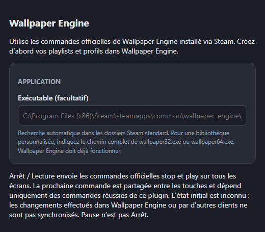

Les captures utilisent des médias de démonstration générés ou un inspecteur hors ligne, pas le profil de l'utilisateur. Les contrôles reposent sur le laboratoire Windows et des témoins inertes, pas sur un deck physique ni une installation Wallpaper Engine réelle. Voir les [notes 0.13.0](docs/RELEASE-0.13.0.md).

## Nouveautés 0.12.0

### Sélecteur d'état Google Home dans les blocs

Dans l'**Atelier**, sélectionnez un bloc d'action de commande Google Home. Ses propriétés proposent **Allumer**, **Éteindre** ou **Basculer** pour l'état à l'appui. Un réglage de luminosité existant reste intact et se modifie dans l'inspecteur du plugin ; ouvrir les propriétés d'un bloc non configuré ne le configure pas tout seul.

### Choisir un groupe

Depuis les **Réglages du plugin** du bloc sélectionné, utilisez **Commander → Groupe** dans l'inspecteur du plugin pour choisir les appareils. De retour dans les propriétés du bloc, NovyDeck indique le nombre d'appareils sélectionnés. Chaque bloc conserve ses propres réglages ; changer l'état garde les cibles choisies. Cette capture de test hors écran emploie un plugin Google Home témoin hors ligne (son action est nommée « Compteur »), pas un compte réel ni un plugin installé.

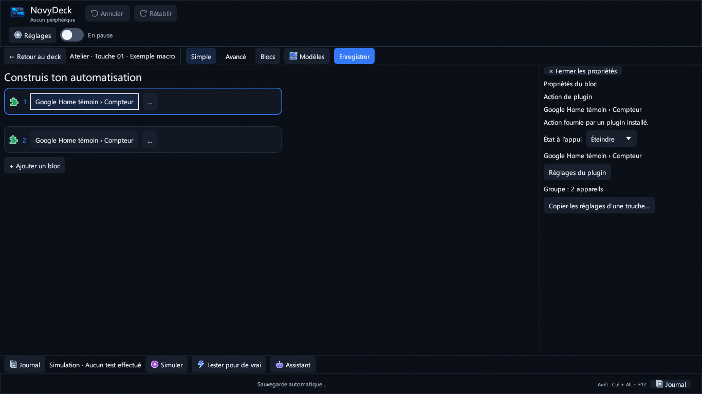

### Plugins séparés

Économiseur OLED et SignalRGB ne sont pas installés automatiquement avec NovyDeck. Installez ou mettez à jour les plugins compatibles séparément si nécessaire, selon leur disponibilité et leurs prérequis. Ces tests d'interface ne prouvent aucun effet sur des appareils Google Home, des écrans ou un deck physique. Voir les [notes 0.12.0](docs/RELEASE-0.12.0.md).

## Nouveautés 0.11.1

### Mise à jour des plugins du magasin

La version 0.11.0 refusait les archives officielles dont le manifeste n'a pas de champ `UUID` à la racine : après confirmation, l'ancienne version restait installée et le bouton **Mettre à jour** demeurait actif. Le remplacement accepte maintenant leur dossier canonique `{identifiant}.sdPlugin` **uniquement si l'identité et la version correspondent** ; les contrôles SHA-256, la sauvegarde, la protection des données locales et le retour arrière restent en place. Après le remplacement, l'application relit le plugin réellement installé avant d'afficher **À jour** ; un échec n'est pas annoncé comme une réussite. Sur la VM, les archives publiques Home Assistant 1.0.3 et Google Home 1.0.5 ont été mises à jour depuis des installations témoins 1.0.2 et 1.0.4 dans des dossiers temporaires, sans toucher aux plugins du PC ni au D6.

### Magasin plus lisible

La grille s'adapte à la largeur et au HiDPI, limite le nombre de colonnes, sépare les versions des badges et évite les libellés verticaux ou tronqués. Les contrôles de rendu couvrent 2614 × 1534 et 1366 × 768 en français et en anglais.

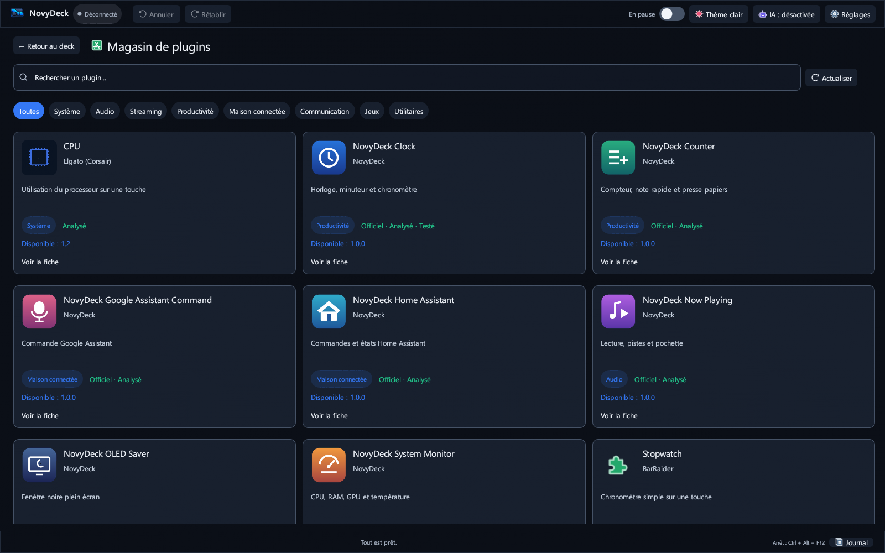

## Nouveautés 0.11.0

### Mises à jour et désinstallation de plugins

Dans le **Magasin de plugins**, les versions installée et disponible sont distinguées. **Mettre à jour** demande confirmation, vérifie l'archive et remplace seulement le plugin choisi avec sauvegarde et retour arrière ; une version inférieure est refusée. **Désinstaller** signale les touches et blocs qui l'utilisent puis demande confirmation. Les profils, références, images et réglages restent conservés ; les actions indisponibles peuvent être réaffectées après réinstallation. La bibliothèque installée est compacte et repliable plugin par plugin.

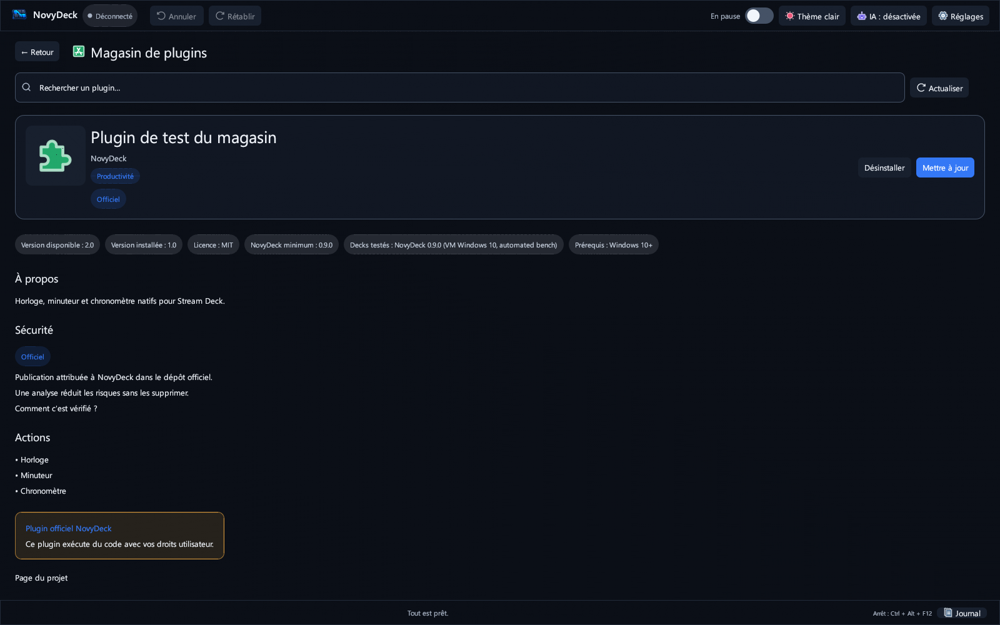
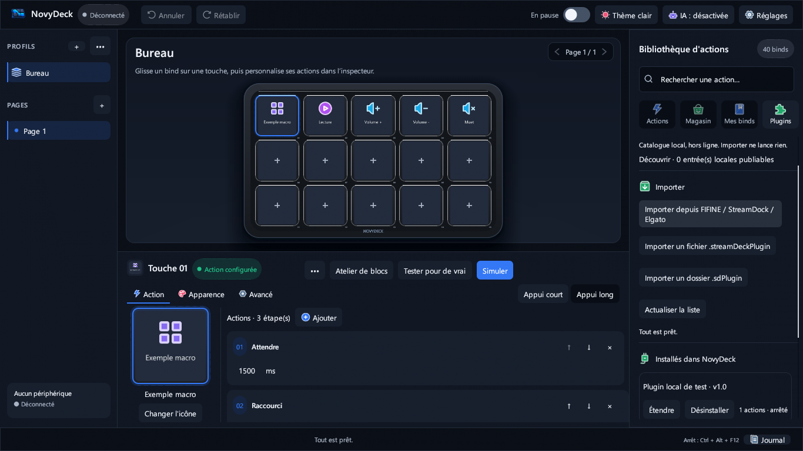

### Bibliothèque défilable et vrais réglages des blocs

Dans l'**Atelier**, les actions sont classées par plugin installé puis catégorie ; la liste défile aussi en petite fenêtre et en HiDPI. Un clic sur un bloc d'action plugin, ou son bouton **Réglages du plugin**, ouvre le véritable inspecteur de l'action. Chaque bloc, même neuf, conserve ses réglages indépendants sans copier une autre touche. Le plugin doit fournir un inspecteur de propriétés pour que ce bouton soit disponible.

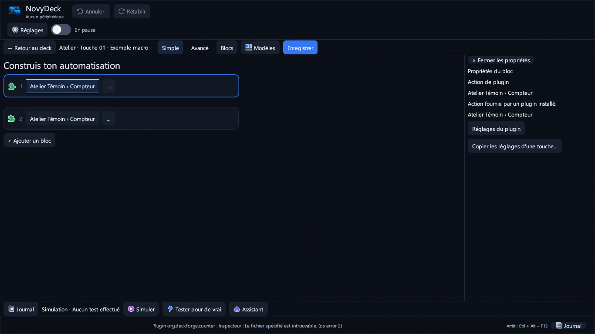

### Faces ON/OFF issues des plugins

Dans l'onglet **Apparence** d'une touche, on peut sélectionner une action plugin directe ou un bloc comme source d'état, puis choisir séparément libellés et images ON/OFF. L'interface distingue l'état **confirmé** par le plugin de l'état **local** ; sans signal valide elle conserve la face de base et n'annonce pas OFF à tort. Les images personnalisées restent prioritaires et les profils existants ne sont pas réécrits. Google Home et Wallpaper Engine doivent passer en **1.0.5** pour émettre ces nouveaux états ; les installations 1.0.4 ne sont pas touchées sans votre choix de mise à jour.

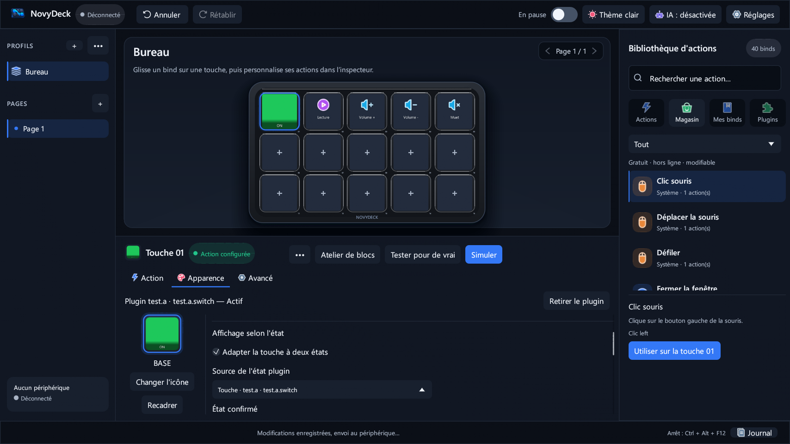
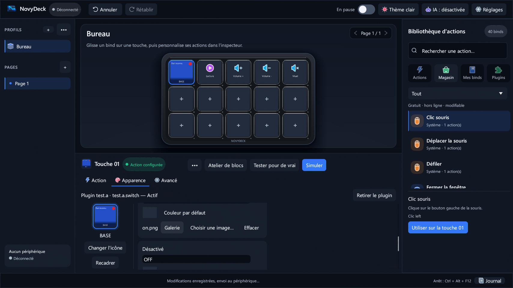

### Tester une action plugin directe

**Tester pour de vrai** accepte aussi une touche qui n'a qu'une action plugin directe, sans blocs de macro. La confirmation explicite et le délai sont conservés ; **Simuler** n'envoie toujours aucune commande au plugin. Les tests automatisés n'ont exercé ni D6 physique, ni compte Google, ni installation Wallpaper Engine réelle.

## Nouveautés 0.10.1

### En-tête du deck plus propre

L'en-tête de la scène du deck a été redessiné : le nom du profil et la phrase d'aide restent dans la carte arrondie avec de vraies marges (un nom de profil trop long est raccourci avec « … » et affiché en entier dans une infobulle), et la navigation entre pages devient un seul contrôle groupé à droite, avec des flèches nettes qui s'éclairent au survol et se grisent quand il n'y a qu'une page. Dans une fenêtre basse, l'en-tête se resserre pour garder des touches lisibles.


### Corrections de l'interface anglaise

Le bouton Annuler s'affiche désormais **Undo** en anglais (il indiquait « Cancel »), et les catégories de la bibliothèque (**System**, **Media**…), les noms d'étapes dans l'inspecteur et le menu **Add** des étapes sont traduits.

## Nouveautés 0.10.0

### Une interface redessinée

NovyDeck change de visage, avec un design inspiré de Linear, Raycast, Figma et du Stream Deck, toujours rendu nativement en Rust avec egui. La disposition que vous connaissez ne bouge pas (navigation à gauche, deck et inspecteur de la touche au centre, bibliothèque d'actions à droite) ; tout le reste a été redessiné :

- **Le deck au premier plan.** Fini le néon bleu : un châssis graphite avec une ombre portée douce, posé sur une scène arrondie. Les touches sont plus sobres, s'éclairent au survol et la touche sélectionnée est marquée par un anneau d'accent.
- **Des contrôles plus calmes.** Les boutons secondaires n'ont plus de contour et s'éclairent au survol ; seule l'action principale de chaque zone (**Simuler**, **Utiliser sur la touche**) est mise en avant. En petite fenêtre, Annuler et Rétablir se réduisent à leurs icônes.
- **Un inspecteur de touche plus clair.** Un en-tête avec l'aperçu de la touche, son nom et une pastille d'état ; des onglets soulignés **Action / Apparence / Avancé** avec le choix **Appui court / Appui long** sur la même ligne ; les étapes présentées en cartes.
- **Une bibliothèque d'actions épurée.** Des lignes sans cadre, une barre d'accent sur l'élément sélectionné, des noms en semi-gras et une carte de détail.
- **Un vrai design system.** Des couleurs plus profondes et moins saturées dans les quatre thèmes (le vôtre change aussi), Segoe UI Semibold pour les titres, petites capitales espacées pour les intitulés de section, une grille d'espacement de 4 pixels, des rayons cohérents, des ombres douces sur les menus et de courtes transitions au survol, coupées par **Réduire les animations**.

Vos profils, images de touches, macros et plugins ne changent pas, et les images envoyées au périphérique restent identiques.

| Thème sombre | Thème clair |
|:--:|:--:|
|  |  |

## Nouveautés 0.9.3

### Badges de sécurité dans le magasin de plugins

Ouvrez **Bibliothèque → Plugins → Magasin de plugins**. Chaque plugin affiche désormais jusqu'à trois badges : **Officiel** (publié par NovyDeck), **Analysé** (l'archive exacte a passé le contrôle automatique) et **Testé par NovyDeck** (cette version précise a été essayée à la main). Le contrôle tourne sur GitHub, sans intervention manuelle, à chaque modification du catalogue et chaque semaine : Microsoft Defender et inspection de l'archive (exécutables et signatures, scripts à risque, manifest, licence et source). Un plugin dont l'analyse est à examiner affiche un avertissement, repris dans la confirmation d'installation. La section **Sécurité** de chaque fiche explique les badges. Une analyse réduit les risques sans les supprimer.

| Magasin avec badges | Section Sécurité d'une fiche |
|:--:|:--:|
|  |  |

### Plugins officiels 1.0.2 : logos et réglages repensés

Les sept plugins NovyDeck ont chacun leur logo, et leurs pages de réglages ont été refaites : une seule langue à la fois (celle de NovyDeck), cartes groupées, aides claires et contrôle des nombres. La fenêtre de réglages est plus compacte, titrée avec le plugin et l'action, et rattachée à NovyDeck. Le moniteur système lit la température du processeur quand Windows la fournit et affiche « N/D » quand un capteur manque. Mettez-les à jour depuis le magasin.


### Mises à jour plus discrètes et finitions

- La mise à jour depuis NovyDeck n'ouvre plus de fenêtre de console noire (le passage 0.9.2 → 0.9.3 est encore lancé par la 0.9.2 et peut l'afficher une dernière fois).
- Les fenêtres secondaires (Réglages, À propos, Assistant IA…) restent centrées et ne se déplacent plus.
- Les touches ON/OFF gardent leur état quand on change de page pendant la session.
- Les textes encore en français dans l'interface anglaise sont traduits ; les touches de plugins affichent des noms lisibles.

Voir les [notes de version](docs/RELEASE-0.9.3.md).

## Nouveautés 0.9.2

### Deux images par touche : marche / arrêt

Sélectionne une touche, puis **Apparence → Adapter la touche à deux états → Interrupteur : change à chaque appui**. Choisis séparément les images **Activé** et **Désactivé** avec **Choisir une image…** ou la galerie. Chaque appui court physique alterne les deux images tout en exécutant l’action habituelle ; un appui long configuré ne change pas l’image. L’état revient à **Désactivé** au démarrage ou après un changement de page/profil. Les touches existantes à image unique ne changent pas.

| Activé (touche verte) | Désactivé (touche orange) |
|:--:|:--:|
|  |  |

### Autres corrections

La fenêtre **Windows et raccourcis** reste centrée et fixe. La barre d’état, le titre de l’Atelier et le journal de simulation respectent désormais la langue anglaise choisie. Les plugins officiels 1.0.1 retirent les cadres noirs autour du texte des touches ; les captures CPU et RAM utilisent des mesures d’un agent Windows de compilation (les données GPU indisponibles restent indiquées comme telles).

## Nouveautés 0.9.0

### Magasin de plugins

Ouvrez **Bibliothèque → Plugins → Magasin de plugins**. Le magasin est une page de l'application, comme l'Atelier de blocs : recherchez, filtrez par catégorie, ouvrez un plugin pour lire sa description, voir ses captures et ses prérequis, puis cliquez sur **Installer**. L'archive n'est téléchargée qu'après votre confirmation et son empreinte SHA-256 est vérifiée avant l'import.

| Magasin | Fiche d'un plugin |
|---|---|
|  |  |

Disponibles dès maintenant : sept **plugins NovyDeck officiels** — Horloge, Compteur, Moniteur système, Lecture en cours, Économiseur OLED, Home Assistant et **Commande Google Assistant** (pilotez vos appareils Google Home avec une commande écrite comme « allume la lumière du salon ») — ainsi que des plugins open source testés dans NovyDeck (Elgato CPU, BarRaider Stopwatch).

### Actions de plugins dans l'Atelier de blocs

La palette **Plugins** liste les actions de chaque plugin installé. Enchaînez des actions de **plugins différents** dans une même macro, avec des attentes, des conditions et tous les autres blocs. L'assistant local comprend les noms des plugins et n'invente jamais une action non installée.


### Démarrer réduit

Quand NovyDeck se lance avec Windows, il peut maintenant rester réduit près de l'horloge sans afficher sa fenêtre (case sous **Lancer NovyDeck au démarrage de Windows**, dans **Windows et raccourcis…**).


## Points forts

- **15 touches LCD personnalisables :** icônes, couleurs, images, GIF et vidéos courtes, avec un aperçu fidèle à l'écran du D6.
- **Profils, pages et dossiers :** changement automatique de profil selon l'application au premier plan.
- **Atelier de blocs :** macros sans script (raccourcis, texte, applications, médias, fenêtres, conditions, répétitions, variables) et simulation avant exécution réelle.
- **Assistant local :** une phrase en français ou en anglais devient des blocs présentés en aperçu. Rien n'est inséré sans validation ; l'IA locale facultative est désactivée par défaut.
- **Plugins Stream Deck / OpenAction :** import des archives `.streamDeckPlugin` et `.sdPlugin`, réglages HTML isolés ([compatibilité](docs/PLUGINS-COMPATIBILITE.md)).
- **Serveur MCP :** utilisation avec Claude, Codex ou Cursor et validation humaine de chaque modification proposée ([guide MCP](docs/MCP.md)).
- **Bibliothèque communautaire de plugins :** parcourez et installez les plugins partagés par la communauté depuis [novydeck-plugins](https://github.com/HatiFlash/novydeck-plugins). NovyDeck ne se connecte qu'avec votre accord, demande confirmation et vérifie l'empreinte SHA-256 de chaque téléchargement ; chaque plugin affiche ses badges de sécurité (Officiel, Analysé, Testé par NovyDeck).
- **Rapport matériel :** vous testez une autre marque de deck ? **Signaler un problème avec mon deck** prépare un rapport anonymisé (avec aperçu) et ouvre une issue GitHub préremplie ; il suffit d'indiquer le modèle du deck et ce qui ne va pas.

## Compatibilité

| Élément | État |
|---|---|
| Windows 10 et 11, 64 bits | Pris en charge ; installateur par utilisateur ou ZIP portable |
| FIFINE AmpliGame D6 (15 touches) | Pris en charge et testé ; périphérique principal |
| Elgato Stream Deck | Testé |
| Autres decks sur base Mirabox (Mirabox, AJAZZ / Stream Dock…) | Devrait fonctionner ; pas encore testé |
| Plugins Stream Deck | Plugins non chiffrés pris en charge ; plugins Elgato chiffrés non pris en charge |
| IA locale (llama.cpp ou Ollama) | Facultative ; désactivée par défaut |
| macOS, Linux | Non pris en charge |

NovyDeck est conçu pour être compatible avec tous les decks. Pour l'instant, il a été testé sur le **FIFINE AmpliGame D6** et l'**Elgato Stream Deck**. Le D6 reposant sur une base matérielle Mirabox, les autres marques qui utilisent cette même base devraient aussi être compatibles, mais elles n'ont pas encore été testées : vos retours sont les bienvenus : utilisez **Signaler un problème avec mon deck** dans l'application, ou ouvrez une [issue](https://github.com/HatiFlash/NovyDeck/issues/new?template=hardware-report.yml).

Fermez FIFINE Control Deck avant d'utiliser le D6 : ce logiciel conserve l'accès USB exclusif au périphérique.

## Démarrage rapide / installation

1. Téléchargez **`NovyDeck-0.9.3-Setup.exe`** depuis la [dernière version](https://github.com/HatiFlash/NovyDeck/releases/latest) et lancez-le sans droits administrateur, ou extrayez `NovyDeck-0.9.3-Windows.zip`. Une nouvelle installation utilise `%LOCALAPPDATA%\Programs\NovyDeck`.
2. Pour une mise à jour, l'installateur met à jour l'installation existante en conservant profils, médias et plugins. En version portable, fermez l'application et remplacez les exécutables sans supprimer `config.json`, les préférences, `assets` ni `plugins`.
3. Lancez NovyDeck depuis le menu Démarrer (ou le dossier portable) et branchez le D6. Pour découvrir l'application sans toucher à vos profils, choisissez **Profils → ••• → Profil de démonstration (15 touches)**. Cette commande réinitialise aussi le profil de démonstration ; vous pouvez le supprimer comme tout autre profil.
4. Glissez une action de la bibliothèque sur une touche, ou ouvrez l'atelier de blocs.

## Galerie

| Atelier de blocs | Assistant local |
|---|---|
|  |  |
| Modifiez le bloc sélectionné dans le panneau de droite. | Prévisualisez une condition avant son ajout. |

| Recadrage des médias | Coins arrondis des touches |
|---|---|
|  |   |
| Aperçu sur la touche sans altérer le fichier d'origine. | Les fonds épousent désormais l'arrondi de chaque touche. |

| Réglages de plugin : Elgato | Réglages de plugin : VolumeController |
|---|---|
|  |  |
|  |  |

Les captures des plugins utilisent des données du banc UI, et non des plugins installés par l'utilisateur.

## Fonctionnalités en détail

### Périphériques

Le **FIFINE AmpliGame D6** est le contrôleur principal : 15 touches LCD avec retour visuel, réglage de la luminosité et mise en veille automatique. L'**Elgato Stream Deck** a également été testé, avec un pilote HID direct, la synchronisation des touches et le retour d'état. Les autres contrôleurs sur base Mirabox (Mirabox, AJAZZ / Stream Dock…) partagent la plateforme matérielle du D6 et devraient fonctionner, mais n'ont pas encore été testés.

### Atelier de blocs

Composez des automatisations en glissant des blocs dans l'interface, sans AutoHotkey ni scripts.


- **Audio :** réglez le volume de l'application au premier plan ou d'un exécutable précis sans modifier le volume général de Windows ; basculez entre casque et enceintes avec mise à jour immédiate de l'icône et du titre de la touche.
- **Streaming et médias :** pilotez scènes, enregistrement, diffusion, replay buffer, sources et micro d'OBS Studio ; utilisez Discord, la soundboard intégrée et les commandes multimédias.
- **Logique :** les blocs si/alors/sinon s'appuient sur 14 conditions en temps réel, notamment fenêtre active, audio en cours, micro muet, casque branché et variables globales ; un bloc « Attendre que… » est aussi disponible.
- **Système et fenêtres :** déplacez ou ancrez les fenêtres, activez-les au premier plan, simulez des touches maintenues avec anti-rebond et déplacez la souris relativement.
- **Actions de plugins :** la palette **Plugins** liste les actions de chaque plugin installé ; enchaînez des actions de plugins différents dans une même macro, avec n'importe quel autre bloc. Chaque bloc garde ses propres réglages, et l'assistant local comprend les noms des plugins (« ajoute le chronomètre de NovyDeck Clock ») sans jamais inventer une action non installée.
- **Variables et déclencheurs :** réagissez à l'ouverture ou à la fermeture d'une application, à une heure donnée ou à un événement audio ; insérez `{heure}`, `{date}` et `{presse_papiers}` dans vos messages et requêtes.

### Plugins Stream Deck et OpenAction

Importez les archives `.streamDeckPlugin` et `.sdPlugin` depuis le magasin intégré, un fichier ou un dossier. Dans **Bibliothèque → Plugins**, cliquez sur **Importer ce plugin** sur une carte, ou utilisez **Importer tout**.


Les exécutables natifs C++/Rust/C#, les scripts Node.js (`@elgato/streamdeck` v2) et les plugins avec moteur HTML (`Runtime::Html`) sont pris en charge. Les inspecteurs de propriétés HTML s'exécutent dans un sous-processus WebView2 isolé (`--isolated-inspector`) derrière un proxy loopback restreint. Les composants `sdpi-components` v3/v4 et BarRaider EasyPI sont embarqués hors ligne, avec intégration du thème sombre. Les réglages se synchronisent dans les deux sens (`setSettings`, `setGlobalSettings`) entre l'interface et le matériel. Les plugins Elgato chiffrés ne sont pas pris en charge.

### Magasin de plugins et bibliothèque communautaire

Ouvrez **Bibliothèque → Plugins**. Le bouton **Magasin de plugins** apparaît en premier, avant les plugins installés. Il ouvre une fenêtre redimensionnable : après votre accord pour la connexion à GitHub, recherchez et filtrez les plugins, consultez leurs descriptions et captures, puis cliquez sur **Installer** dans la fiche détaillée. Les imports locaux restent disponibles hors ligne sous ce bouton.

1. **Installés dans NovyDeck** : les plugins déjà importés depuis un fichier, un dossier ou le catalogue intégré. Glissez leurs actions sur une touche comme n'importe quelle autre action.
2. **Communauté** : un annuaire public de plugins maintenu dans [HatiFlash/novydeck-plugins](https://github.com/HatiFlash/novydeck-plugins).

**Plugins NovyDeck officiels** (natifs, sans Node.js, compatibles aussi avec le logiciel Elgato ; sources dans [first-party/](https://github.com/HatiFlash/novydeck-plugins/tree/main/first-party)) : **Horloge** (horloge, minuteur, chronomètre), **Compteur** (compteur, note rapide, presse-papiers), **Moniteur système** (CPU, RAM, GPU), **Lecture en cours** (titre et pochette du morceau), **Économiseur OLED** (écran noir sur le moniteur choisi), **Home Assistant** (basculer des entités, appeler des services, afficher des capteurs) et **Commande Google Assistant** (envoie une commande écrite comme « allume la lumière du salon » à vos appareils Google Home, avec votre propre projet Google Cloud). Des plugins open source sélectionnés (Elgato CPU, BarRaider Stopwatch) sont listés après avoir été testés dans NovyDeck.

Fonctionnement de la bibliothèque communautaire :

- NovyDeck reste hors ligne tant que vous n'avez pas cliqué sur **Se connecter au magasin** ; il télécharge alors uniquement le catalogue (`registry.json`) depuis GitHub.
- Chaque carte indique le nom, la version, l'auteur, la licence, les decks testés et la version minimale de NovyDeck. Des badges indiquent si un plugin est **Officiel**, **Analysé** automatiquement et **Testé par NovyDeck** ; les autres plugins communautaires portent la mention **Communauté — non vérifié**.
- **Installer…** ouvre une confirmation avec l'adresse de téléchargement et l'empreinte SHA-256 attendue. NovyDeck télécharge l'archive, vérifie son empreinte et l'importe seulement ensuite. Une empreinte identique prouve que le fichier est bien celui référencé, pas que le code tiers est sûr : n'installez que des plugins de confiance.

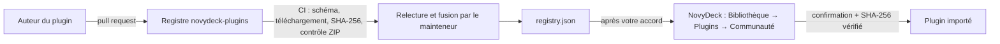

**Partager votre plugin :** publiez un `.streamDeckPlugin` (ou un `.zip` contenant un dossier `.sdPlugin`) à une adresse HTTPS stable, calculez son SHA-256 (`certutil -hashfile fichier SHA256` sous Windows), ajoutez une entrée à `registry.json` selon le [schéma](https://github.com/HatiFlash/novydeck-plugins/blob/main/schema/registry.schema.json) et ouvrez une pull request. La CI vérifie l'entrée automatiquement et le mainteneur décide de la publication. Guide complet : [CONTRIBUTING.fr.md](https://github.com/HatiFlash/novydeck-plugins/blob/main/CONTRIBUTING.fr.md). Le bouton **Proposer un plugin** de l'application ouvre la même page.

### Médias et recadrage

Recadrez images et vidéos sans modifier les originaux avant de les envoyer sur une touche : modes Remplir ou Ajuster/letterbox, zoom 0,5×–3,0×, recentrage et aperçu instantané sur la touche. Media Foundation sous Windows décode les vidéos courtes sans FFmpeg ; les GIF en boucle sont pris en charge. La galerie accepte les images PNG, JPEG, WebP et SVG transparents ainsi que les animations.

### Fiabilité et import Elgato

NovyDeck conserve les cinq dernières sauvegardes rotatives saines (`backups/config-*.bak`) et propose une restauration guidée sans écraser les données valides avec un fichier corrompu. Importez en une étape une archive Elgato `.StreamDeckProfilesBackup` complète, avec détection et conversion automatiques de ses profils. La simulation de macros ne provoque aucun effet de bord système non sollicité.

### Intégration MCP

Le serveur Model Context Protocol intégré se connecte à Claude Desktop, Claude Code, Codex CLI ou Cursor depuis la barre d'outils IA. Ces assistants peuvent explorer les profils et proposer des dispositions de touches et des macros ; chaque modification proposée apparaît en aperçu et exige une validation explicite avant application. La connexion en un clic ne nécessite aucune édition manuelle de configuration JSON.

### Interface et rendu

L'interface utilise le rendu matériel wgpu (DirectX 12 / Vulkan, avec repli OpenGL). La grille des touches s'adapte à la taille de la fenêtre et à la résolution de l'écran. Les touches LCD peuvent afficher des images, des GIF animés et de courtes vidéos en boucle. Les profils sont organisables en dossiers et peuvent changer automatiquement au lancement d'une application.

## Langues

L'interface est disponible en **français** et en **anglais**. Au premier démarrage, NovyDeck suit la langue de Windows ; changez-la dans **Réglages → Langue**. Chaque langue est un simple fichier JSON dans [`res/i18n/`](res/i18n) : pour ajouter la vôtre, copiez `en.json`, traduisez les valeurs et ouvrez une pull request. Voir le [guide de traduction](docs/TRANSLATING.md).

## Confidentialité

NovyDeck fonctionne hors ligne. L'IA locale reste sur votre PC ; elle est facultative et désactivée par défaut. L'IA connectée et les plugins réseau ne s'activent qu'avec votre accord explicite. Les actions proposées par un assistant s'affichent en aperçu avant insertion ou application.

## Documentation

[Identité visuelle](docs/DESIGN.md) · [MCP et IA](docs/MCP.md) · [Architecture des plugins](docs/PLUGINS-ARCHITECTURE.md) · [Compatibilité des plugins](docs/PLUGINS-COMPATIBILITE.md) · [Import Elgato](docs/ELGATO.md) · [Tests périphériques](docs/TEST-PERIPHERIQUES.md) · [Guide des médias](scripts/media/README.md)

## Dernière version

- **0.15.0 :** en-tête du deck plus clair et sections Modèles/Enregistrés ; inspecteur de touche plus spacieux ; conversations avec l'assistant, propositions structurées à relire et clarification de plugin.
- **0.14.0 :** mises à jour/désinstallation transactionnelles, bibliothèque compacte, sélecteur défilable, inspecteurs de blocs indépendants, faces ON/OFF et test direct des actions plugin.
- **0.10.1 :** en-tête du deck plus propre (textes dans la carte, flèches de page groupées et grisées s'il n'y a qu'une page) ; corrections de l'interface anglaise (Undo, catégories, noms d'étapes, menu Add).
- **0.10.0 :** interface redessinée avec un nouveau design system : scène du deck graphite sans néon, boutons sans contour, inspecteur de touche plus clair avec onglets soulignés, bibliothèque épurée, couleurs plus profondes dans tous les thèmes et titres en semi-gras. Profils, médias et plugins conservés.
- **0.9.3 :** badges de sécurité dans le magasin (analyse automatique sur GitHub) ; plugins officiels 1.0.2 avec logos et réglages repensés ; plus de console pendant la mise à jour ; fenêtres secondaires fixes ; état ON/OFF conservé entre les pages.
- **0.9.2 :** deux images Activé/Désactivé par touche alternent à l’appui court physique ; textes anglais et panneau Windows fixe ; plugins officiels 1.0.1 sans cadres noirs, aperçus CPU/RAM mesurés.
- **0.9.1 :** le magasin de plugins devient une page fixe de l'application (plus de fenêtre flottante), avec bouton retour et Échap ; les blocs de plugins de l'Atelier affichent les noms lisibles du plugin et de l'action ; le README présente les nouveautés 0.9.0 avec captures.
- **0.9.0 :** fenêtre **Magasin de plugins** façon Play Store (recherche, catégories, fiche avec captures, installation en un clic avec contrôle SHA-256) ; sept plugins NovyDeck officiels et des plugins open source testés ; **actions de plugins dans l'Atelier de blocs**, combinables entre plugins et comprises par l'assistant local ; option **démarrer réduit** quand NovyDeck se lance avec Windows.
- **0.8.15 :** interface en anglais avec choix de la langue (**Réglages → Langue**) et traductions communautaires sous forme de simples fichiers JSON ; vérification facultative des mises à jour au démarrage (demandée une fois) ; notes de version affichées avant d'installer une mise à jour et fenêtre **Quoi de neuf** après.
- **0.8.14 :** mise à jour depuis l'application : **À propos → Vérifier les mises à jour** interroge la dernière release GitHub ; **Télécharger et installer** vérifie l'empreinte SHA-256 de l'installateur, ferme NovyDeck, installe par-dessus (profils, médias et plugins conservés) puis le relance. Les copies portables sont renvoyées vers la page de téléchargement.
- **0.8.13 :** l'action **Basculer l'audio** peut être déposée sur une touche avant de choisir ses deux périphériques, réglés ensuite dans l'inspecteur ; elle était auparavant refusée avec « Choisis deux périphériques audio différents ».
- **0.8.12 :** bibliothèque communautaire de plugins (Bibliothèque → Plugins → Communauté), rapport matériel anonymisé avec issue GitHub préremplie, et le bouton **Recadrer** sous l'aperçu de la touche n'est plus coupé.
- **0.8.11 :** inscription NOVYDECK sur le châssis, avec test UI et actualisation des captures et de la vidéo.
- **0.8.10 :** préservation de la transparence du logo utilisateur dans les PNG et toutes les tailles d'icônes Windows ; génération reproductible des ressources et test de non-régression du canal alpha.

Consultez les [versions publiées sur GitHub](https://github.com/HatiFlash/NovyDeck/releases) pour les notes complètes.

## Compiler depuis les sources

NovyDeck est développé en Rust. La compilation et les tests utilisent les dépendances verrouillées ; la création de l'installateur Windows nécessite Inno Setup 6 ou 7.

```bash
git clone https://github.com/HatiFlash/NovyDeck.git
cd NovyDeck
cargo build --release --locked
cargo test --locked
powershell -ExecutionPolicy Bypass -File tools\Build-Installer.ps1 -Version 0.9.3 -Build
```

## Licence et crédits

NovyDeck est distribué sous [licence MIT](LICENSE). Le dépôt source ne contient aucun binaire tiers propriétaire, aucune archive protégée ni aucun pack de ressources fermé. Les icônes d'interface proviennent d'[IconPark](https://github.com/bytedance/IconPark) (ByteDance), sous licence Apache 2.0 ; seuls les pictogrammes utilisés sont embarqués et recolorés pour NovyDeck ([notice](res/iconpark/NOTICE.md), [licence](res/iconpark/LICENSE)). Consultez [THIRD-PARTY-NOTICES.txt](THIRD-PARTY-NOTICES.txt) pour les mentions relatives aux dépendances libres et bibliothèques embarquées.
