English · [Français](README.fr.md)

<div align="center">
  
  <h1>NovyDeck</h1>
  <p>Open-source Windows software for stream decks: keys, macros, media and plugins, without the official software. Tested on the FIFINE AmpliGame D6 and the Elgato Stream Deck.</p>
  <p><a href="https://hatiflash.github.io/NovyDeck/">Explore the NovyDeck website</a></p>
  <p>
    <a href="https://github.com/HatiFlash/NovyDeck/releases/tag/v0.14.0"></a>
    <a href="LICENSE"></a>
    
  </p>
</div>


<sub>Actual interface capture rendered off-screen at 2560 × 1600 with the included “NovyDeck Demo / README” profile; no device connected.</sub>

## Presentation video

[](docs/media/novydeck-demo.mp4)

A 40-second presentation film in 1920 × 1080 at 60 fps with sound, made with Remotion and three.js. It features a 3D D6 deck, actual interface captures and synthesized music. The published film was produced outside this repository.

## What's new in 0.15.0

### A clearer deck header and library

On the main deck screen, the header now labels whether key actions are running or paused. The library names its **Templates** and **Saved** sections directly.

<!-- TODO: Insert a generated 0.15.0 English main-screen capture here; no 0.15.0 capture is available yet. -->

### More room in the key inspector

Select a key to view its action steps in the inspector; the layout keeps initial steps visible at compact and HiDPI sizes. The **Appearance** tab remains scrollable for its controls.

<!-- TODO: Insert a generated 0.15.0 English inspector capture here; no 0.15.0 capture is available yet. -->

### Assistant conversations and reviewable proposals

From an empty key, choose **Ask the assistant** to open **Workshop → Assistant**. Requests and replies appear in conversation order. A recognized proposal shows its block count and a structured preview, including nested branches; you must review and choose **Add** or **Apply** before it changes the key. Built-in deterministic rules remain available without an AI model. An optional local AI model can handle requests beyond those rules; it is not universal plugin comprehension, and plugin actions/settings are validated rather than assumed. No particular model or successful hardware behavior is implied.

<!-- TODO: Insert a generated 0.15.0 English assistant capture here; no 0.15.0 capture is available yet. -->

### Explicit running and paused status

The main-screen status makes it easier to distinguish active key execution from paused execution. The UI behavior is covered by tests; this does not claim a physical-device test.

## What's new in 0.14.0

### Direct block editing in the Workshop

Open a key, then choose **Workshop → Simple**. Drag a block by its handle to reorder it or nest it in a **Then**, **Else** or **Repeat** branch. Hold **Ctrl** while dragging to duplicate it; press **Esc** to cancel. **Undo** and **Redo** cover edits, and dragging near a panel edge autoscrolls. Click a block to edit it in the **Properties** panel.

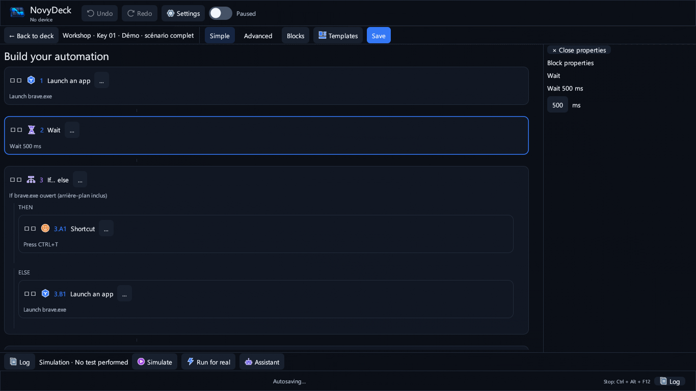

### Refreshed What's new cards and honest progress

From **Settings → About**, check for updates. The update offer and **What's new** window present the release notes in readable cards; the install dialog separates download, SHA-256 verification, installation and relaunch. Progress remains indeterminate when no reliable byte count is available—NovyDeck never displays a guessed percentage.

| Update offer | What's new |
| --- | --- |
| 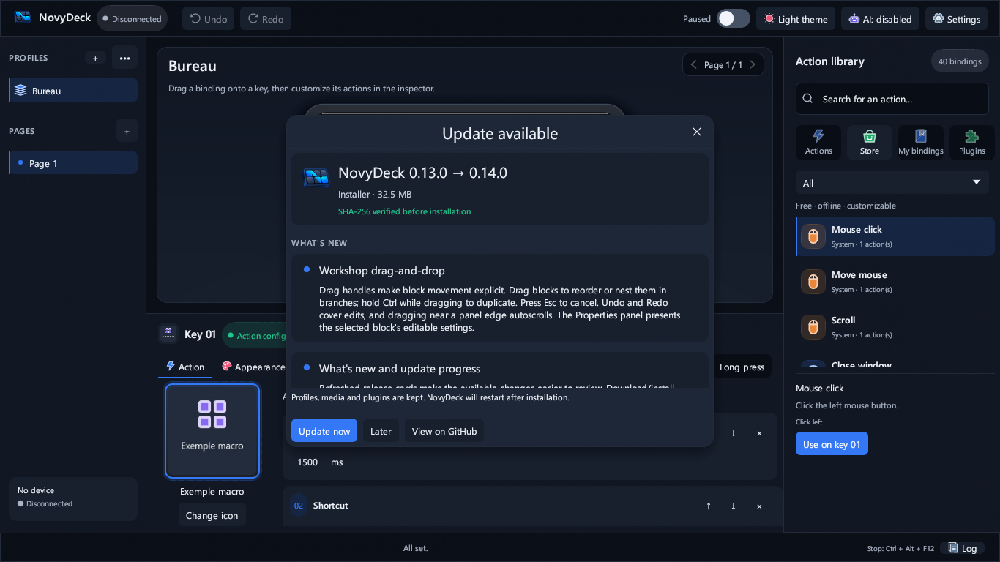 | 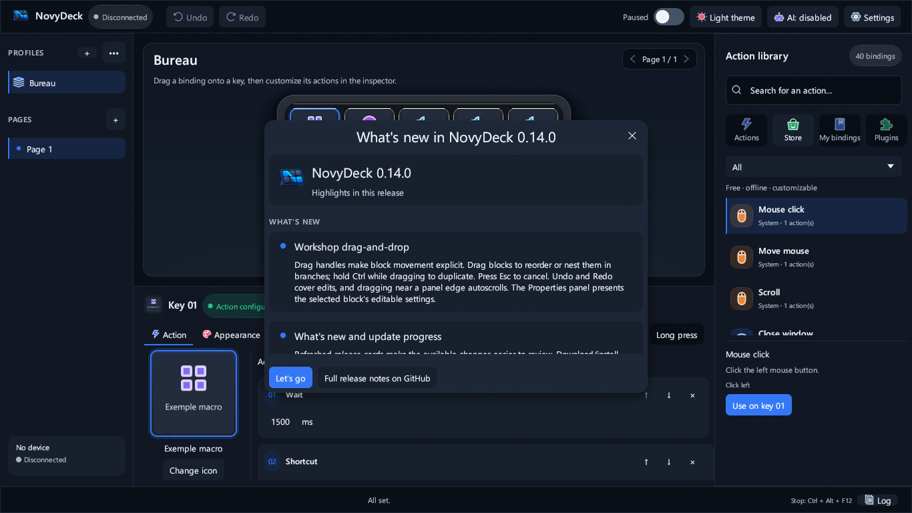 |

### Assistant and installed plugin actions

In **Workshop → Assistant**, describe the action you want. The local assistant uses installed plugin manifests to identify actions and asks which plugin, action or target you mean when the request is ambiguous. It refuses to invent private inspector settings; configure those in the plugin's own inspector. This is not universal plugin comprehension, and no block is inserted until you review and apply the proposal. A local AI model is needed for requests beyond the built-in rules.

## What's new in 0.13.0

### Safer physical folder navigation

Opening a folder and returning to the home page must consume the navigation gesture instead of triggering the key at the same position in the destination. Physical key tracking now survives page synchronization and ignores repeated down reports until release.

### Responsive key feedback

HID key events explicitly wake the interface for processing instead of waiting for an unrelated repaint. The LCD preview cache also tracks the title-overlay choice. This fixes the tested software paths; no physical D6 latency measurement is claimed, and plugin updates still depend on the plugin's response.

### Text without an added background

In a key's **Appearance** tab, clear **Background and shadow behind the title** (Fond et ombre derrière le titre) to keep only the title over your image. Existing profiles retain their current appearance by default. The saved setting applies to the preview and the image sent to the device.

| Background enabled | Background disabled |
| --- | --- |
| 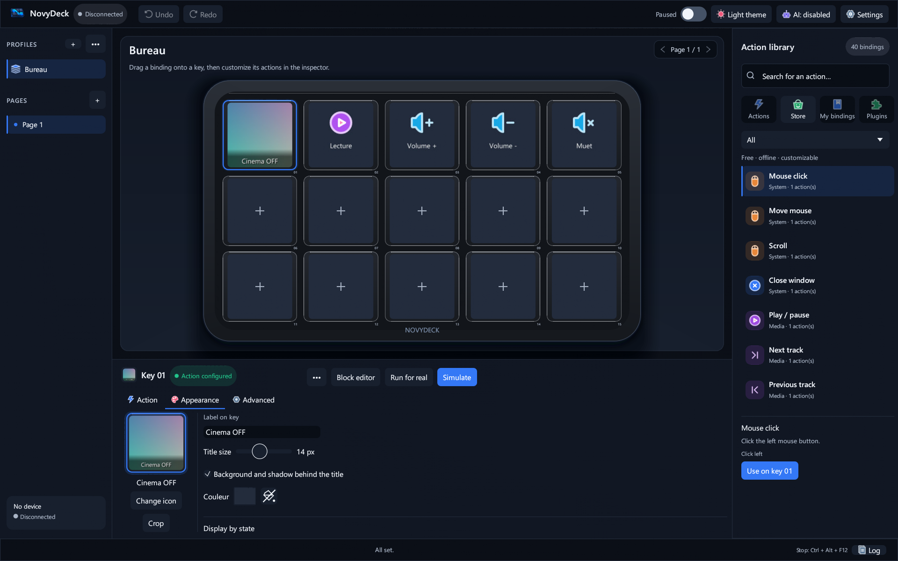 | 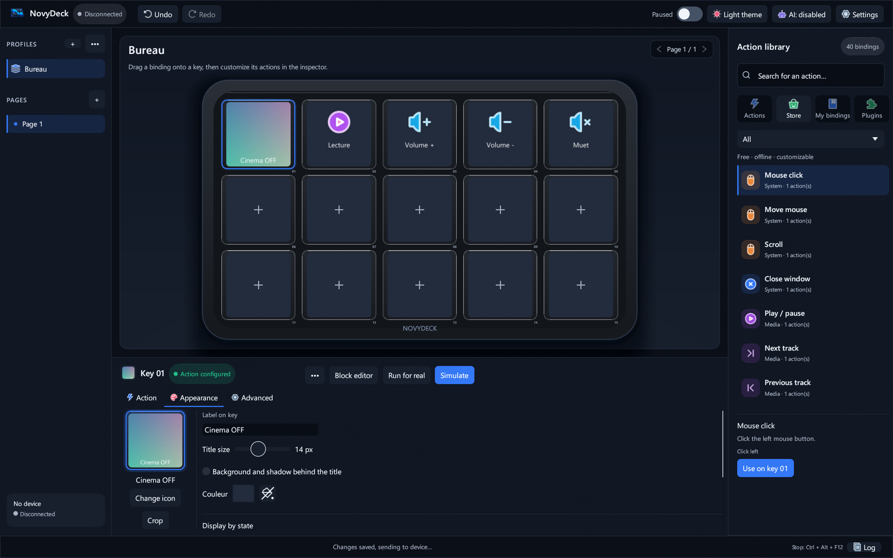 |

### A scrollable Add action menu

In the key inspector's **Action** tab, the **Add** menu now has a bounded height and scrolls to the final action, including compact windows and HiDPI.

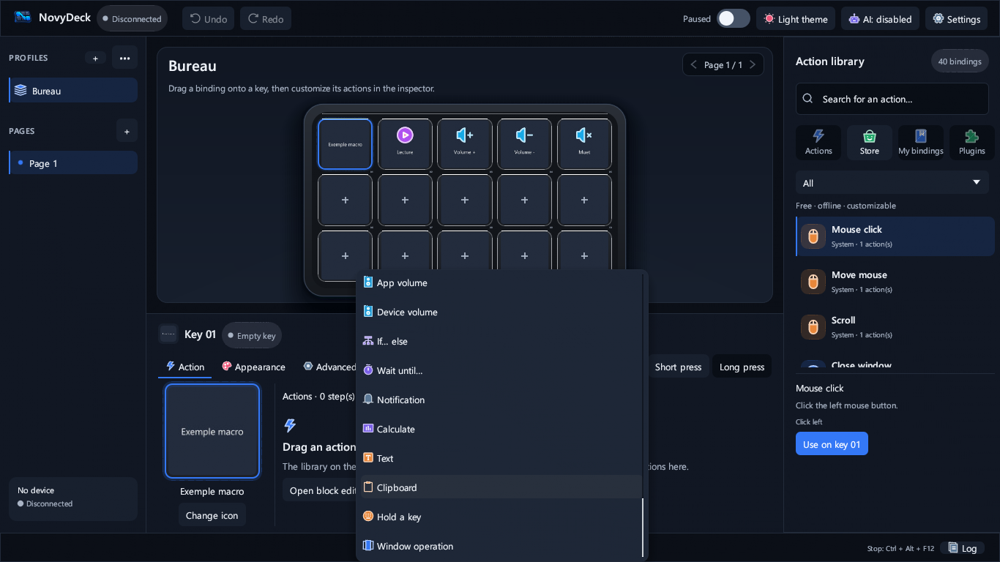

### Wallpaper Engine Stop / Play

Update the separate Wallpaper Engine plugin to **1.0.6** in the store, then choose **Stop / Play (all screens)** from its installed actions. One key alternates Stop and Play, without removing the separate commands or Pause / Play. It uses shared **local command state**, not a live reading of Wallpaper Engine. The first press sends Stop; failed commands do not flip the state. Updating NovyDeck does not automatically update this plugin.

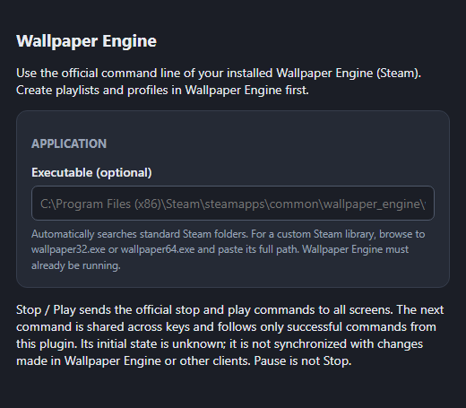

Screenshots use generated demo media or an offline inspector, not the user's profile. Checks use the Windows lab and inert fixtures, not a physical deck or a real Wallpaper Engine installation. See the [0.13.0 release notes](docs/RELEASE-0.13.0.md).

## What's new in 0.12.0

### Google Home state selector for blocks

In **Workshop**, select a Google Home control action block. Its properties offer **On**, **Off** or **Toggle** (Allumer, Éteindre, Basculer) for the state at press time. An existing brightness setting remains intact and is edited in the plugin inspector; an unconfigured block is not changed just by opening its properties.

### Choosing a group

From the selected block's **Plugin settings** (Réglages du plugin), use **Control → Group** (Commander → Groupe) in the plugin inspector to choose devices. Back in block properties, NovyDeck shows the selected device count. Settings are saved separately for each block; changing the state keeps the selected targets. This off-screen test capture uses an offline Google Home demo fixture (its action is named “Compteur”), not an installed plugin or a live account.

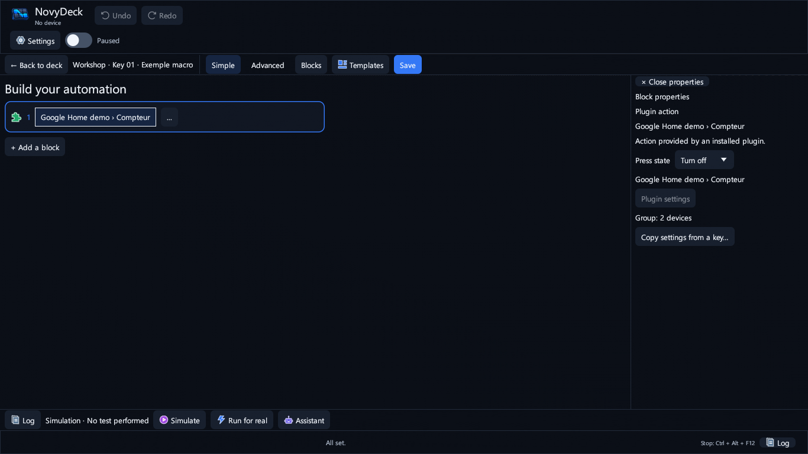

### Plugins remain separate

OLED Saver and SignalRGB are not installed automatically with NovyDeck. Install or update compatible plugins separately when needed, subject to their availability and prerequisites. These UI tests do not establish any effect on Google Home devices, displays or physical decks. See the [0.12.0 release notes](docs/RELEASE-0.12.0.md).

## What's new in 0.11.1

### Store plugin updates

Version 0.11.0 rejected official archives whose manifest has no root-level `UUID` field. The previous version therefore remained installed and **Update** stayed active after confirmation. Replacement now accepts their canonical `{id}.sdPlugin` folder **only when the identity and version match**. SHA-256 checks, backups, local-data protection and rollback remain in place. The app rereads the committed plugin before showing **Up to date**; it does not report a failed update as successful. On the lab VM, public Home Assistant 1.0.3 and Google Home 1.0.5 archives upgraded temporary 1.0.2 and 1.0.4 fixtures. Neither the user's PC/plugins nor the physical D6 were touched.

### Readable plugin store

The card grid adapts to window width and HiDPI, limits its column count, separates versions from security badges and prevents labels from collapsing into vertical letters. Off-screen layout checks cover 2614 × 1534 and 1366 × 768 in both languages.

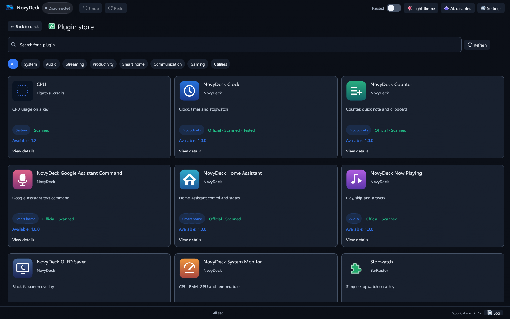

## What's new in 0.11.0

### Plugin updates and removal

Open the **Plugin Store** to compare the installed and available versions. **Update** asks for confirmation, checks the archive and replaces only the selected plugin with a backup/rollback path; downgrades are refused. **Uninstall** reports keys and blocks that use it and asks for confirmation. The profiles, references, images and configuration are not deleted; unavailable actions can be reassigned after reinstalling. The installed plugin list is compact and each entry expands independently.

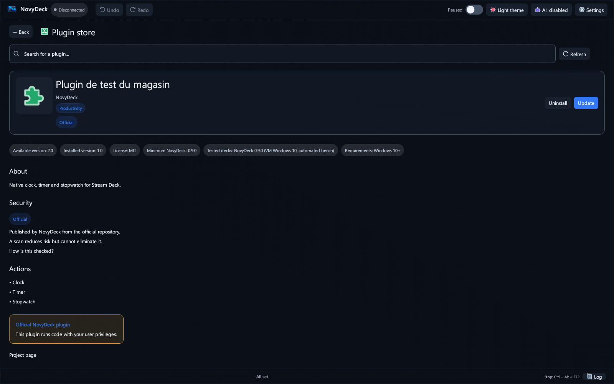
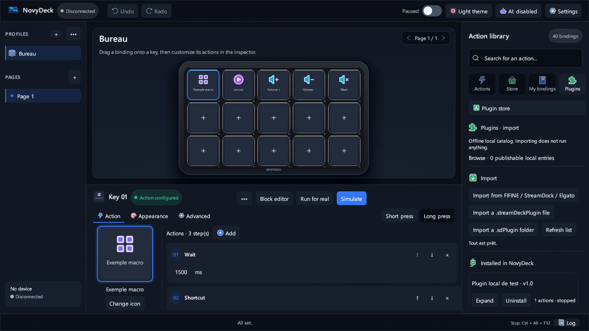

### A browsable plugin library and real block settings

In the **Workshop**, the plugin action picker groups actions by installed plugin and category, with scrolling for compact windows and HiDPI. Click a plugin action block or its **Plugin settings** button to open that action's native plugin inspector. Each block has its own settings, including new blocks; the settings are saved and restored without copying another key. This requires a plugin that actually provides a Property Inspector.

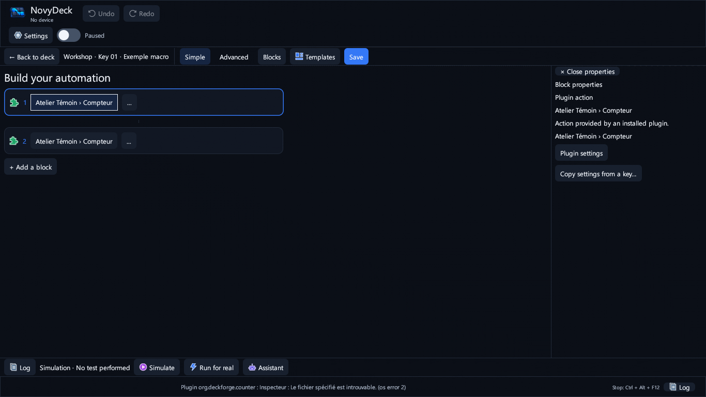

### Plugin-reported ON/OFF faces

In a key's **Appearance**, choose a direct plugin action or a plugin block as the state source, then set separate ON and OFF labels/images. The UI distinguishes a **confirmed** plugin report from a **local** state; when no valid report exists it falls back to the base face instead of falsely claiming OFF. User-selected key images take precedence and existing profiles are not rewritten. The Google Home and Wallpaper Engine plugins need their **1.0.5** updates to emit the new state signals; the 1.0.4 installations are left untouched until you choose to update.

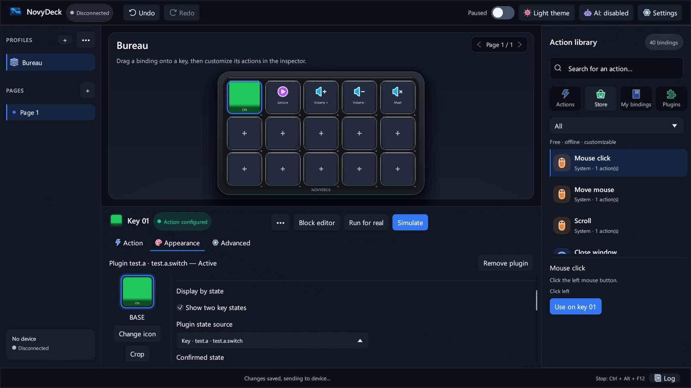
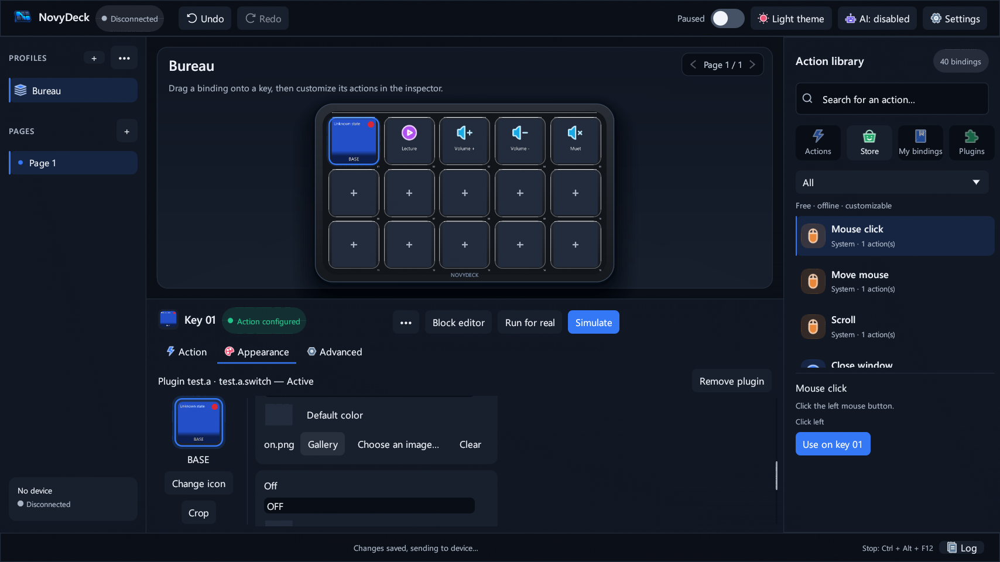

### Testing a direct plugin action

**Test for real** also supports a key with a single direct plugin action (no macro blocks). It retains the explicit confirmation and execution delay; **Simulate** still sends no plugin command. No physical D6, Google account or Wallpaper Engine installation was exercised by the automated tests.

## What's new in 0.10.1

### Cleaner deck header

The header of the deck stage was redrawn: the profile name and the help line now sit inside the rounded card with proper margins (a long profile name is shortened with "…" and shown in full in a tooltip), and page navigation is a single grouped control on the right, with crisp drawn arrows that highlight on hover and are greyed out when there is only one page. In low windows the header gets more compact so the keys stay large.


### English interface fixes

The Undo button now reads **Undo** (it said "Cancel"), and library categories (**System**, **Media**…), step names in the key inspector and the **Add** step menu are translated.

## What's new in 0.10.0

### A redesigned interface

NovyDeck has a new visual design, inspired by Linear, Raycast, Figma and the Stream Deck, still rendered natively in Rust with egui. The layout you know stays the same (navigation on the left, deck and key inspector in the middle, action library on the right); everything else was redrawn:

- **The deck is the hero.** No more blue neon glow: a graphite chassis with a soft drop shadow, on a rounded stage. Keys are calmer, light up on hover and show the selected key with an accent ring.
- **Calmer controls.** Secondary buttons no longer have outlines and brighten on hover; only the main action of each area (**Simulate**, **Use on key**) is highlighted. In small windows, Undo and Redo shrink to icon buttons.
- **A clearer key inspector.** A header with the key preview, its name and a status badge; underlined **Action / Appearance / Advanced** tabs with the **Short press / Long press** switch on the same line; steps shown as cards.
- **A cleaner action library.** Flat rows with a highlight bar on the selected item, semibold names and a details card.
- **A real design system.** Deeper, less saturated colours in all four themes (your current theme changes too), Segoe UI Semibold for titles, small spaced capitals for section labels, a 4-pixel spacing grid, consistent radii, soft shadows on menus, and short hover transitions that turn off with **Reduce animations**.

Your profiles, key images, macros and plugins are untouched, and the images sent to the device do not change.

| Dark theme | Light theme |
|:--:|:--:|
|  |  |

## What's new in 0.9.3

### Security badges in the plugin store

Open **Library → Plugins → Plugin store**. Each plugin now shows up to three badges: **Official** (published by NovyDeck), **Scanned** (the exact archive passed the automatic check) and **Tested by NovyDeck** (that exact version was tried by hand). The check runs on GitHub, with no manual step, every time the catalogue changes and every week: Microsoft Defender plus a static inspection of the archive (executables and signatures, risky scripts, manifest, licence and source). A plugin whose scan needs review shows a warning, also highlighted in the install confirmation. The **Security** section of each plugin page explains the badges. A scan reduces risk; it cannot rule it out completely.

| Store with badges | Security section of a plugin page |
|:--:|:--:|
|  |  |

### Official plugins 1.0.2: logos and cleaner settings

The seven NovyDeck plugins each have their own logo, and their settings pages were redesigned: one language at a time (following NovyDeck), grouped cards, clear help and number checks. The settings window is smaller, titled with the plugin and action, and attached to NovyDeck. The System Monitor reads the CPU temperature when Windows exposes it and shows "N/A" when a sensor is unavailable. Update them from the plugin store.


### Quieter updates and polish

- Updating from inside NovyDeck no longer opens a black console window (the 0.9.2 → 0.9.3 update is still started by 0.9.2 and may show it one last time).
- Secondary windows (Settings, About, AI assistant…) stay centered and can no longer be dragged around.
- ON/OFF keys keep their state when you switch pages during the session.
- Remaining French texts in the English interface are translated; plugin keys show readable plugin and action names.

See the [release notes](docs/RELEASE-0.9.3.md).

## What's new in 0.9.2

### Two images for a key: ON / OFF

Choose a key, open **Appearance → Show two key states → Switch: change on each press**, then select an image separately for **On** and **Off** using **Choose an image…** or the gallery. A short physical press alternates the two images while running the key's normal action; a configured long press does not change the image. The key starts **Off** when NovyDeck opens or when you switch pages or profiles. Existing single-image keys are unchanged.

| On (green key) | Off (orange key) |
|:--:|:--:|
|  |  |

### Other fixes

The **Windows and shortcuts** dialog stays centered and cannot be dragged. The status bar, block editor title and simulation journal now respect the selected English language. Official plugins 1.0.1 remove dark boxes around key text; CPU and RAM screenshots use measurements from a Windows build runner (unavailable GPU data is still shown as unavailable).

## What's new in 0.9.0

### Plugin store

Open **Library → Plugins → Plugin store**. The store is a page of the app, like the block editor: search, filter by category, open a plugin to read its description, see its screenshots and requirements, then click **Install**. The archive is downloaded only after your confirmation and its SHA-256 fingerprint is checked before import.

| Store | Plugin page |
|---|---|
|  |  |

Available today: seven **official NovyDeck plugins** — Clock, Counter, System Monitor, Now Playing, OLED Saver, Home Assistant and **Google Assistant Command** (control your Google Home devices with a written command such as “turn on the living room light”) — plus open-source plugins tested in NovyDeck (Elgato CPU, BarRaider Stopwatch).

### Plugin actions in the block editor

The **Plugins** palette lists the actions of every installed plugin. Chain actions from **different plugins** in the same macro, with delays, conditions and any other block. The local assistant understands plugin names and never invents an action that is not installed.


### Start minimized

When NovyDeck starts with Windows, it can now stay minimized near the clock without showing its window (option under **Start NovyDeck when Windows starts**, in **Windows and shortcuts…**).


## Highlights

- **15 customizable LCD keys:** icons, colors, images, GIFs and short videos, with a preview matching the D6 display.
- **Profiles, pages and folders:** automatically switch profiles based on the foreground application.
- **Visual block editor:** build macros without scripts using shortcuts, text, applications, media, windows, conditions, loops and variables; simulate before running for real.
- **Local assistant:** turn a sentence in English or French into previewed blocks. Nothing is inserted without confirmation; optional local AI is off by default.
- **Stream Deck / OpenAction plugins:** import `.streamDeckPlugin` and `.sdPlugin` packages with isolated HTML settings ([compatibility, French](docs/PLUGINS-COMPATIBILITE.md)).
- **MCP server:** work with Claude, Codex or Cursor while approving every proposed change ([MCP guide, French](docs/MCP.md)).
- **Community plugin library:** browse and install plugins shared by the community from [novydeck-plugins](https://github.com/HatiFlash/novydeck-plugins). NovyDeck only connects after you agree, asks for confirmation and verifies each download's SHA-256; each plugin shows its security badges (Official, Scanned, Tested by NovyDeck).
- **Hardware report:** testing another deck brand? **Signaler un problème avec mon deck** (“Report a problem with my deck”) prepares an anonymized report (preview first) and opens a pre-filled GitHub issue; just add your deck model and what goes wrong.

## Compatibility

| Component | Status |
|---|---|
| Windows 10 and 11, 64-bit | Supported; per-user installer or portable ZIP |
| FIFINE AmpliGame D6 (15 keys) | Supported and tested; primary device |
| Elgato Stream Deck | Tested |
| Other Mirabox-based decks (Mirabox, AJAZZ / Stream Dock…) | Expected to work; not tested yet |
| Stream Deck plugins | Unencrypted plugins supported; encrypted Elgato plugins not supported |
| Local AI (llama.cpp or Ollama) | Optional; disabled by default |
| macOS, Linux | Not supported |

NovyDeck is designed to work with any stream deck. So far it has been tested on the **FIFINE AmpliGame D6** and the **Elgato Stream Deck**. Since the D6 is built on Mirabox hardware, other brands based on the same Mirabox platform should also be compatible, but they have not been tested yet — reports are welcome: use **Signaler un problème avec mon deck** (“Report a problem with my deck”) in the app, or open an [issue](https://github.com/HatiFlash/NovyDeck/issues/new?template=hardware-report.yml).

Close FIFINE Control Deck before using the D6: it holds exclusive USB access to the device.

## Quick start / installation

1. Download **`NovyDeck-0.9.3-Setup.exe`** from the [latest release](https://github.com/HatiFlash/NovyDeck/releases/latest) and run it without administrator rights, or extract `NovyDeck-0.9.3-Windows.zip`. A fresh installation uses `%LOCALAPPDATA%\Programs\NovyDeck`.
2. For updates, the installer updates an existing installation while preserving profiles, media and plugins. For a portable installation, close the app and replace the executables without deleting `config.json`, preferences, `assets` or `plugins`.
3. Launch NovyDeck from the Start menu (or the portable folder) and connect the D6. To explore without changing your profiles, choose **Profiles → ••• → Demo profile (15 keys)**. The same command resets the demo profile; you can also delete it like any other profile.
4. Drag an action from the library onto a key, or open the block editor.

## Gallery

| Block editor | Local assistant |
|---|---|
|  |  |
| Edit the selected block in the right panel. | Preview a conditional action before adding it. |

| Media cropping | Rounded key corners |
|---|---|
|  |   |
| Preview on the key without changing the original file. | Backgrounds now follow the shape of each key. |

| Plugin settings: Elgato | Plugin settings: VolumeController |
|---|---|
|  |  |
|  |  |

The plugin screenshots use UI test data, not installed user plugins.

## Features in detail

### Devices

The **FIFINE AmpliGame D6** is the primary controller, with 15 LCD keys, visual feedback, brightness control and automatic sleep. The **Elgato Stream Deck** has also been tested, using a direct HID driver with key synchronization and state feedback. Other Mirabox-based controllers (Mirabox, AJAZZ / Stream Dock…) share the D6's hardware platform and should work, but have not been tested yet.

### Visual block editor

Compose automations by dragging blocks in the interface, without AutoHotkey or scripts.


- **Audio:** adjust the foreground app or a specific executable without changing Windows master volume; switch between headset and speakers and immediately update the key icon and label.
- **Streaming and media:** control OBS Studio scenes, recording, streaming, replay buffer, sources and microphone; use Discord, the built-in soundboard and media controls.
- **Logic:** if/then/else blocks draw on 14 real-time conditions, including active window, playing audio, muted microphone, connected headset and global variables; a wait-until block is also available.
- **System and windows:** move or snap windows, bring them forward, simulate held keys with debounce and move the mouse relatively.
- **Plugin actions:** the **Plugins** palette lists the actions of every installed plugin; chain actions from different plugins in the same macro, mixed with any other block. Each plugin block keeps its own settings, and the local assistant understands plugin names (“add the stopwatch from NovyDeck Clock”) without ever inventing an action that is not installed.
- **Variables and triggers:** react to applications opening or closing, scheduled times or audio events; insert dynamic values such as `{heure}`, `{date}` and `{presse_papiers}` into messages and requests.

### Stream Deck and OpenAction plugins

Import `.streamDeckPlugin` and `.sdPlugin` packages from the built-in store, a file or a folder. In **Library → Plugins**, choose **Import this plugin** on a card, or use **Import all**.


Native C++/Rust/C# executables, Node.js scripts (`@elgato/streamdeck` v2) and plugins with an HTML backend (`Runtime::Html`) are supported. HTML property inspectors run in an isolated WebView2 subprocess (`--isolated-inspector`) behind a restricted loopback proxy. Offline `sdpi-components` v3/v4 and BarRaider EasyPI are included, with dark-theme integration. Settings synchronize both ways (`setSettings`, `setGlobalSettings`) between the UI and hardware. Encrypted Elgato plugins are not supported.

### Plugin store and community library

Open **Library → Plugins** (**Bibliothèque → Plugins** in the French interface). The **Plugin store** button is first, above installed plugins. It opens a resizable window: after consenting to the GitHub connection, search or filter the community catalog, inspect descriptions and screenshots, then choose **Install** on the detail page. Installed plugins remain available in the tab below the button; local imports work offline.

1. **Installed in NovyDeck** (*Installés dans NovyDeck*): plugins already imported from a file, a folder or the built-in catalog. Drag one of their actions onto a key like any other action.
2. **Community** (*Communauté*): a public directory of plugins maintained in [HatiFlash/novydeck-plugins](https://github.com/HatiFlash/novydeck-plugins).

**Official NovyDeck plugins** (native, no Node.js required, also compatible with the Elgato software; source in [first-party/](https://github.com/HatiFlash/novydeck-plugins/tree/main/first-party)): **Clock** (clock, timer, stopwatch), **Counter** (counter, quick note, clipboard), **System Monitor** (CPU, RAM, GPU), **Now Playing** (title and cover of the current track), **OLED Saver** (black screen on the chosen monitor), **Home Assistant** (toggle entities, call services, show sensors) and **Google Assistant Command** (send a written command such as “turn on the living room light” to your Google Home devices, with your own Google Cloud project). Selected open-source plugins (Elgato CPU, BarRaider Stopwatch) are listed after being tested in NovyDeck.

How the community library works:

- NovyDeck stays offline until you click **Connect to the store**; it then downloads only the catalog (`registry.json`) from GitHub.
- Each card shows the name, version, author, license, tested decks and minimum NovyDeck version. Badges show whether a plugin is **Official**, **Scanned** automatically and **Tested by NovyDeck**; other community plugins are labelled **Community — unverified**.
- **Install…** opens a confirmation with the download address and the expected SHA-256. NovyDeck downloads the archive, checks its fingerprint and only then imports it. A matching fingerprint proves the file is the one listed, not that third-party code is safe: install only plugins you trust.

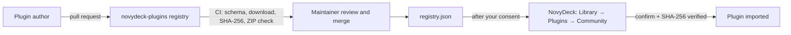

**Share your plugin:** publish a `.streamDeckPlugin` (or a `.zip` containing an `.sdPlugin` folder) at a stable HTTPS address, compute its SHA-256 (`certutil -hashfile file SHA256` on Windows), add an entry to `registry.json` following the [schema](https://github.com/HatiFlash/novydeck-plugins/blob/main/schema/registry.schema.json) and open a pull request. CI checks the entry automatically and the maintainer decides on publication. Full guide: [CONTRIBUTING.md](https://github.com/HatiFlash/novydeck-plugins/blob/main/CONTRIBUTING.md). The **Propose a plugin** button in the app opens the same page.

### Media and cropping

Crop images and videos non-destructively before sending them to a key: Fill or Fit/letterbox, 0.5×–3.0× zoom, repositioning and an immediate key preview. Windows Media Foundation decodes short videos without requiring FFmpeg; looping GIFs are supported. The gallery accepts PNG, JPEG, WebP and transparent SVG images as well as animations.

### Reliability and Elgato import

NovyDeck retains the last five healthy rotating backups (`backups/config-*.bak`) and offers guided restoration without overwriting good data with a corrupted file. Import a complete Elgato `.StreamDeckProfilesBackup` archive in one step, with automatic detection and conversion of its profiles. Macro simulation has no unsolicited system side effects.

### MCP integration

The built-in Model Context Protocol server connects to Claude Desktop, Claude Code, Codex CLI or Cursor from the AI toolbar. Assistants can inspect profiles and propose key layouts and macros; every proposed change is previewed and requires explicit approval before it is applied. No JSON configuration editing is required for the one-click connection.

### Interface and rendering

The interface uses hardware-accelerated wgpu rendering (DirectX 12 / Vulkan, with OpenGL fallback). Its key grid adapts to window size and display resolution. LCD keys can display images, looping GIFs and short videos. Profiles can be organized into folders and switched automatically when an application starts.

## Languages

The interface is available in **English** and **French**. NovyDeck follows the Windows language on first start; change it in **Settings → Language**. Each language is a single JSON file in [`res/i18n/`](res/i18n): to add yours, copy `en.json`, translate the values and open a pull request. See the [translation guide](docs/TRANSLATING.md).

## Privacy

NovyDeck works offline. Local AI stays on your PC and is optional and disabled by default; connected AI and network-enabled plugins are activated only with your explicit consent. Proposed assistant actions are previewed before insertion or application.

## Documentation

[Visual design (French)](docs/DESIGN.md) · [MCP and AI (French)](docs/MCP.md) · [Plugin architecture (French)](docs/PLUGINS-ARCHITECTURE.md) · [Plugin compatibility (French)](docs/PLUGINS-COMPATIBILITE.md) · [Elgato import (French)](docs/ELGATO.md) · [Device tests (French)](docs/TEST-PERIPHERIQUES.md) · [Media guide (French)](scripts/media/README.md)

## Latest release

- **0.11.1:** official plugin store updates accept verified archives without a root UUID; responsive store cards. Version 0.12.0 is prepared above, not yet published.
- **0.11.0:** transactional plugin updates/removal, compact installed library, scrolling action picker, independent block inspectors, plugin ON/OFF faces and direct-action test.
- **0.10.1:** cleaner deck header (texts inside the card, grouped page arrows greyed out on a single page); English fixes (Undo, library categories, step names, Add menu).
- **0.10.0:** redesigned interface with a new design system: graphite deck stage without neon glow, outline-free buttons, clearer key inspector with underlined tabs, cleaner action library, deeper colours in all themes and Semibold titles. Profiles, media and plugins are kept.
- **0.9.3:** security badges in the plugin store (automatic GitHub scan); official plugins 1.0.2 with logos and cleaner settings; no console during in-app updates; fixed secondary windows; ON/OFF state kept across pages.
- **0.9.2:** keys can alternate two user-selected ON/OFF images on short physical presses; English text and a fixed Windows and shortcuts dialog; official plugins 1.0.1 improve key text and CPU/RAM previews.
- **0.9.1:** the plugin store is now a fixed page of the app (no floating window), with a back button and Esc; plugin blocks in the block editor show readable plugin and action names; README presents the 0.9.0 features with screenshots.
- **0.9.0:** Play Store-style **plugin store** window (search, categories, detail page with screenshots, one-click install with SHA-256 check); seven official NovyDeck plugins plus tested open-source plugins; **plugin actions in the block editor**, combinable across plugins, understood by the local assistant; **start minimized** option when NovyDeck starts with Windows.
- **0.8.15:** English interface with a language selector (**Settings → Language**) and community translations as simple JSON files; optional update check at startup (asked once); release notes shown before installing an update and a **What's new** window after it.
- **0.8.14:** update from the app: **À propos → Vérifier les mises à jour** (About → Check for updates) checks the latest GitHub release; **Télécharger et installer** (Download and install) verifies the installer's SHA-256, closes NovyDeck, installs over it (profiles, media and plugins kept) and restarts it. Portable copies are pointed to the download page.
- **0.8.13:** the **Basculer l'audio** (audio switch) action can be dropped onto a key before choosing its two devices, which are then set in the inspector; previously it was rejected with “Choisis deux périphériques audio différents”.
- **0.8.12:** community plugin library (**Bibliothèque → Plugins → Communauté**), anonymized hardware report with a pre-filled GitHub issue, and the **Crop** button under the key preview is no longer cut off.
- **0.8.11:** NOVYDECK lettering on the deck chassis, with UI test coverage and updated captures and video.
- **0.8.10:** preserve the user's transparent logo across PNGs and Windows icon sizes; add reproducible resource generation and an alpha-channel regression test.

See [GitHub Releases](https://github.com/HatiFlash/NovyDeck/releases) for full release notes.

## Build from source

NovyDeck is written in Rust. Build and test with locked dependencies; building the Windows installer requires Inno Setup 6 or 7.

```bash
git clone https://github.com/HatiFlash/NovyDeck.git
cd NovyDeck
cargo build --release --locked
cargo test --locked
powershell -ExecutionPolicy Bypass -File tools\Build-Installer.ps1 -Version 0.9.3 -Build
```

## License & credits

NovyDeck is distributed under the [MIT license](LICENSE). The source repository does not include proprietary third-party binaries, protected archives or closed resource packs. Interface icons come from [IconPark](https://github.com/bytedance/IconPark) (ByteDance), licensed under Apache 2.0; only the icons in use are bundled and recolored for NovyDeck ([notice](res/iconpark/NOTICE.md), [license](res/iconpark/LICENSE)). See [THIRD-PARTY-NOTICES.txt](THIRD-PARTY-NOTICES.txt) for notices covering open-source dependencies and bundled libraries.
